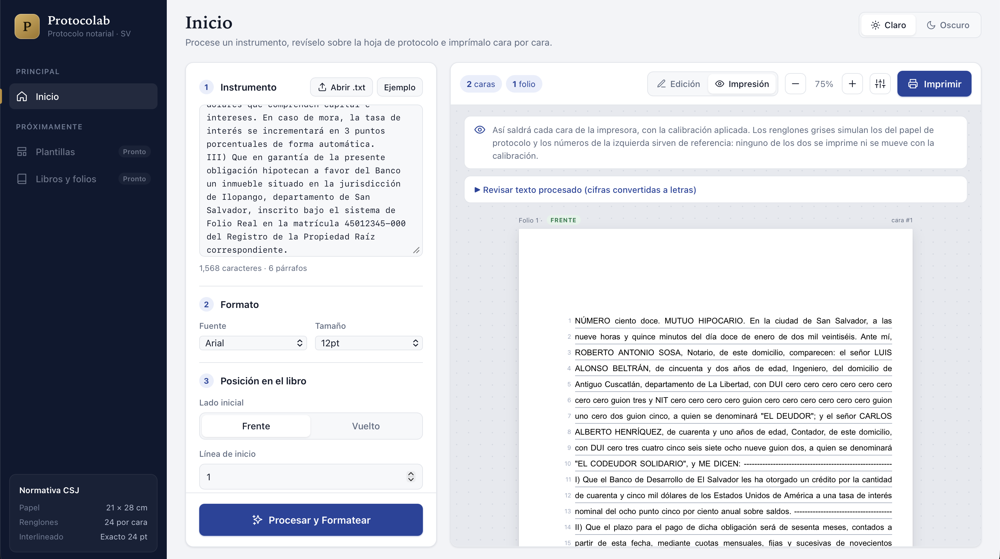
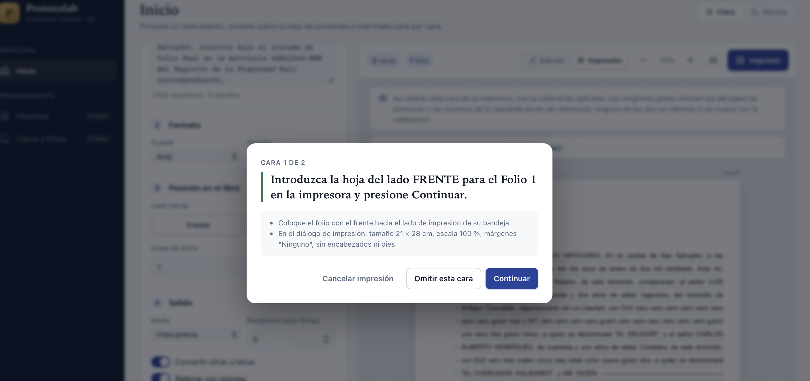

# Protocolab

Maquetación e impresión asistida de **Libros de Protocolo Notarial** según la normativa de la Sección de Notariado de la CSJ de El Salvador. Requisitos completos en [ESPECIFICACION.md](ESPECIFICACION.md).

## Requisitos

- Node.js 20 o superior (`brew install node` o https://nodejs.org)

Si Node no está instalado en el sistema, el proyecto incluye una copia portátil en `.tools/node` (no se versiona). Para usarla en la terminal:

```bash
export PATH="$PWD/.tools/node/bin:$PATH"
```

## Uso

```bash
npm install
```

Desarrollo (API en :3001 y frontend con recarga en :5173):

```bash
npm run dev
```

Producción (un solo servidor en http://localhost:3001 que entrega API y frontend):

```bash
npm run build && npm start
```

Pruebas del backend:

```bash
npm test
```


## Capturas





## Estructura

```
server/                      API Express + TypeScript
  src/index.ts               Servidor y endpoint POST /api/format-protocol
  src/protocolo.ts           Validación de la petición y orquestación
  src/types.ts               Contrato tipado de petición/respuesta
  src/constantes.ts          Papel 21×28 cm, 24 renglones, márgenes frente/vuelto
  src/texto/numeroALetras.ts Enteros, decimales, montos, fechas, horas, ordinales → letras
  src/texto/procesarTexto.ts Detección de cifras en el texto legal y limpieza (viñetas, negritas)
  src/maquetacion/metricas.ts  Anchos de glifo (Arial/Helvetica, Times, Courier) para cortar renglones
  src/maquetacion/maquetador.ts Reparto en caras de 24 renglones, guiones, bloque de cierre y firmas
  test/                      Pruebas (node:test)
client/                      React + TypeScript (Vite)
  src/App.tsx                Componente principal + hoja de estilos (incluye @media print)
  src/components/            Panel de ajustes, hoja de protocolo, modal de impresión
  src/useImpresionAsistida.ts Cola de impresión cara por cara
```

## API

`POST /api/format-protocol`

```json
{
  "texto": "NÚMERO 25. COMPRAVENTA. ...\nPaso ante mí: DOY FE.",
  "lineaInicio": 1,
  "tamanoFuente": "12pt",
  "tipoFuente": "Arial",
  "ladoInicial": "frente",
  "modoSalida": "documento-completo",
  "folioInicial": 1,
  "lineasFirma": 4,
  "convertirNumeros": true,
  "rellenarGuiones": true
}
```

Los cuatro últimos campos son opcionales. Respuesta: `pages: Array<{ id, folioNum, type, content, finDeParrafo }>` y `meta` (totales, texto procesado y advertencias). `content` siempre tiene exactamente 24 renglones separados por `\n`.

## Reglas implementadas

- **Cifras a letras:** fechas (`15/03/2024`), horas (`10:30`, `3:15 p.m.` → formato de 24 horas), montos (`$1,250.50`, `300 dólares` → “… dólares de los Estados Unidos de América con … centavos de dólar”), porcentajes, decimales, ordinales (`1°`), DUI/NIT y cualquier cifra con guiones (dígito por dígito), pasaportes alfanuméricos, cifras con cero inicial o de 10 o más dígitos.
- **Guiones:** el último renglón de cada párrafo se completa con guiones hasta el margen derecho.
- **Cierre y firmas:** desde «Paso ante mí» hasta el final (más los renglones para firmas) nunca se parte entre caras. Si no cabe, los renglones sobrantes se inutilizan con guiones y el bloque pasa a la cara siguiente; si el cuerpo termina en el renglón 24 del frente, el cierre empieza en el renglón 1 del vuelto.
- **Corte de renglones:** el servidor estima anchos con las métricas AFM de cada fuente (Arial es métricamente idéntica a Helvetica) y deja un 1.5 % de holgura; el navegador justifica cada renglón.

## Testimonio

> **Oculto por ahora:** la interfaz solo ofrece Protocolo, porque los testimonios se redactan en Word. Para volver a mostrar el selector, cambie `MOSTRAR_TESTIMONIO` a `true` en `client/src/constantes.ts`. La API sigue aceptando testimonios.

Con el selector visible, en Inicio elija **Tipo de documento → Testimonio** para generar la copia en papel bond:

- Solo se configuran papel (Carta 21.59 × 27.94 cm u Oficio 21.59 × 33.02 cm), fuente y tamaño. Márgenes de 2.5 cm por lado e interlineado 1.5. No aplican frente/vuelto, línea de inicio ni folio de posición.
- El texto fluye de corrido (sin cortes cada 24 renglones). La vista previa pagina el texto con las medidas reales del navegador, de modo que se imprime exactamente lo que se ve.
- Al final se agrega automáticamente la Razón de Testimonio: «PASÓ ANTE MÍ: Al Folio … al Folio … de mi Protocolo Número …, que vence el presente año; y para seguridad de …, expido este … TESTIMONIO, en la ciudad de …, a los … días del mes de … de …, el cual sello y firmo en hojas de papel bond útiles.»
- Los folios («Del folio» / «Al folio») y el número de protocolo se escriben a mano en la sección de la razón. Con «Convertir cifras a letras» activo, folios, número de libro y fecha se escriben en letras.

En la API, envíe `"tipoDocumento": "testimonio"` y el objeto `testimonio` (`tamanoPapel`, `interlineado`, `libroNumero`, `folioInicial`, `folioFinal`, `nombreCliente`, `numeroTestimonio`, `fechaExpedicion` AAAA-MM-DD y `ciudad` opcional). La respuesta trae `testimonio.parrafos` (el último es la razón) y `pages` vacío.

## Impresión asistida

El botón **Imprimir** recorre las caras visibles una por una. Antes de cada una muestra «Introduzca la hoja del lado FRENTE/VUELTO para el Folio X…»; al presionar **Continuar** inyecta una regla `@media print` que oculta todas las demás caras y llama a `window.print()`.

En el diálogo del navegador: tamaño de papel 21 × 28 cm (cree el tamaño personalizado en la impresora si no existe), escala 100 %, márgenes «Ninguno», sin encabezados ni pies de página.

**Calibración:** si la impresora desplaza la impresión, ajuste X/Y en milímetros desde «Calibración» y haga una prueba en papel bond activando «Imprimir renglones guía».
